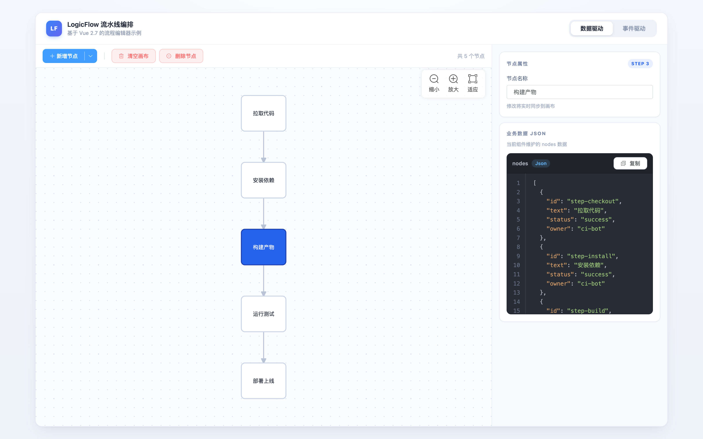
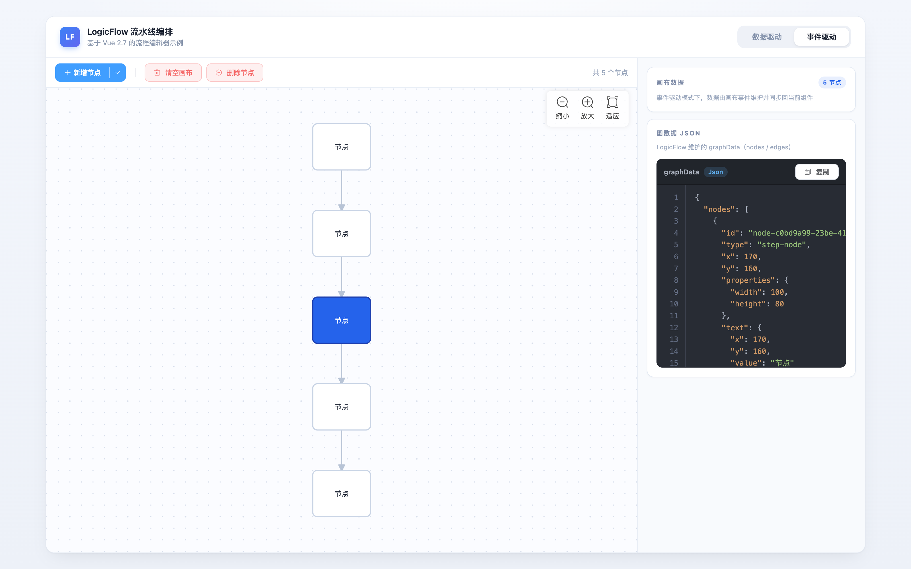

# LogicFlow Vue Exp

基于 **Vue + LogicFlow + Vite** 的实践经验（Experience）示例集，用于沉淀 LogicFlow 在 Vue 项目中的集成范式。当前包含「流水线编排（Pipeline）」画布示例，提供「数据驱动」与「事件驱动」两种集成范式，演示节点的增删、自动连线、Dagre 布局与图数据同步。

> 说明：当前实现基于 Vue 2.7，代码以纯 JavaScript + Options API 编写，依赖封装与框架解耦，可低成本迁移到 Vue 3（更换 `@vitejs/plugin-vue` + Vue 3 入口写法即可）。

## 界面预览

| 数据驱动 | 事件驱动 |
| -------- | -------- |
|  |  |

> 数据驱动模式：业务侧维护 `nodes` 数组，选中「构建产物」（蓝色高亮）后可在右侧栏编辑名称，并实时查看 `nodes` JSON；事件驱动模式：通过工具栏直接创建节点、操作 LogicFlow 底层图数据，右侧栏展示画布维护的 `graphData` JSON。

## 功能

- 双模式切换：顶部开关在「数据驱动」与「事件驱动」之间切换
  - **数据驱动**：业务侧只维护 `nodes` 数组（`.sync`），图结构由数据派生；右侧侧栏可直接编辑选中节点名称并实时同步到画布
  - **事件驱动**：直接操作 LogicFlow 底层图数据（节点 / 边模型），通过事件向外通知变更
- 新增节点：默认追加到末节点下方并自动连线；有选中节点时支持「插到选中节点前 / 后」
- 删除节点：自动把上游 × 下游交叉桥接，保持图连通
- 清空画布、适应屏幕（自动 Dagre 布局，Control 插件提供缩放 / 适应控件）
- 侧栏数据预览：数据驱动展示 `nodes`、事件驱动展示 `graphData`，highlight.js 语法高亮
- 连线只读：自定义边不可命中，仅作连线展示
- 选中节点高亮：蓝色填充 + 白色文字，悬停描边高亮
- 自定义节点 `step-node` 与边 `step-edge`

## 技术栈

| 类别     | 选型                                                          |
| -------- | ------------------------------------------------------------- |
| 框架     | Vue 2.7（当前实现，可低成本迁移 Vue 3）                       |
| 流程引擎 | [LogicFlow](https://github.com/didi/LogicFlow) 2.x（`@logicflow/core` + `@logicflow/layout` 的 Dagre 布局 + `@logicflow/extension` 的 Control 控件） |
| 构建工具 | Vite 7                                                        |
| UI       | Element UI 2.x + Tailwind（`@tailwindcss/postcss7-compat`，类名前缀 `tw-`）+ highlight.js |
| 包管理器 | pnpm                                                          |

## 环境要求

- Node.js >= 20.19（Vite 7 要求；或 >= 22.12）
- pnpm >= 9

## 快速开始

```bash
# 安装依赖
pnpm install

# 启动开发服务器
pnpm dev

# 生产构建
pnpm build

# 预览构建产物
pnpm preview

# 格式化代码（Prettier）
pnpm format

# 校验代码格式
pnpm format:check
```

开发服务器默认地址见终端输出（通常为 `http://localhost:5173`）。

## 目录结构

```
.
├── index.html                     # HTML 入口
├── vite.config.js                 # Vite 配置（@/ 别名 → src/）
├── jsconfig.json                  # JS 项目配置（路径别名）
├── package.json
├── pnpm-lock.yaml
└── src
    ├── main.js                    # 应用入口，挂载 Vue 实例
    ├── App.vue                    # 根组件：双模式切换器
    ├── styles.css                 # 全局样式（@layer components）
    ├── utils/index.js             # uuid 等工具
    ├── views
    │   ├── reactive.vue           # 数据驱动视图
    │   └── classic.vue            # 事件驱动视图
    └── components/lf
        ├── LogicFlow.vue          # LogicFlow 通用封装
        ├── LogicFlowContext.vue   # 画布实例 provide/inject 透传
        ├── model.js               # LogicFlowPro（响应式 graphModel + getLastNode）
        ├── events.js              # 图数据变更事件常量
        ├── nodes/                 # 自定义节点 step-node（StepNode.js / index.js）
        ├── edges/                 # 自定义边 step-edge（StepEdge.js / index.js）
        └── scenes/
            ├── PipelineClassic.vue    # 事件驱动场景（工具栏 + CRUD）
            └── PipelineReactive.vue   # 数据驱动场景（mixin 复用 Classic 工具栏）
```

## 使用说明

1. 顶部开关切换「数据驱动 / 事件驱动」视图。
2. 工具栏操作（由场景组件提供）：
   - **新增节点**：默认追加到末节点；下拉菜单可选「插到选中节点前 / 后」
   - **适应屏幕**：自动 Dagre 布局并适配画布
   - **删除节点**：删除选中节点并桥接上下游
   - **清空画布**：清空所有节点
3. 数据驱动视图：右侧「节点属性」侧栏可编辑选中节点名称，修改实时同步到画布。

## 组件说明

### `LogicFlow.vue`（通用封装）

| 属性        | 类型   | 默认值 | 说明                                                         |
| ----------- | ------ | ------ | ------------------------------------------------------------ |
| `options`   | Object | `{}`   | LogicFlow 编辑配置，合并覆盖默认只读配置                       |
| `graphData` | Object | `{}`   | 外部图数据，deep watch 后渲染                                 |
| `teleport`  | String | `''`   | 外部容器选择器；指定后画布挂载到该容器，组件内不再渲染容器     |

| 事件               | 载荷         | 说明                                       |
| ------------------ | ------------ | ------------------------------------------ |
| `update:graphData` | 图数据对象   | 图数据变更时向外同步（`_.cloneDeep`）        |

### `PipelineClassic.vue`（事件驱动场景）

| 属性          | 类型   | 默认值   | 说明             |
| ------------- | ------ | -------- | ---------------- |
| `defaultText` | String | `'节点'` | 新节点的默认文案 |

| 事件           | 载荷                 | 说明         |
| -------------- | -------------------- | ------------ |
| `select`       | `{ node, index }`    | 选中节点变化 |
| `node-add`     | 节点模型             | 新增节点后   |
| `node-delete`  | 节点 id              | 删除节点后   |
| `canvas-clear` | `null`               | 清空画布后   |

### `PipelineReactive.vue`（数据驱动场景）

| 属性          | 类型     | 默认值                   | 说明                       |
| ------------- | -------- | ------------------------ | -------------------------- |
| `nodes`       | Array    | `[]`                     | 业务节点列表，支持 `.sync` |
| `nodeFactory` | Function | `() => ({ text: '节点' })` | 新节点工厂函数             |

| 事件           | 载荷       | 说明             |
| -------------- | ---------- | ---------------- |
| `update:nodes` | 节点数组   | 业务节点变更时触发 |

## 自定义节点 / 边

- `step-node`（`StepNode.js`）：圆角矩形（8px），选中时蓝色填充 + 白色文字，悬停描边高亮；文本支持自动换行。
- `step-edge`（`StepEdge.js`）：折线边，`isHitable = false` 仅作连线展示，不响应用户操作。

## 说明

- 默认关闭编辑态交互（隐藏锚点、禁止节点 / 连线文本编辑等），连线仅由场景组件自动生成，不支持手动创建。
- `node_modules/`、`dist/` 等构建产物与系统文件已在 `.gitignore` 中忽略。
